# Deriv AKO

**AKO (Automated Kanban Orchestrator)** is an open-source release manager. It picks up work that's ready on your board, opens a release named after its tag, merges the linked pull requests, tells QA, and once a release manager approves, tags the tested commit, publishes a GitHub Release and reports how the deploy went.

Talk to it from the terminal, or bring in your team through Slack.



> **Status: early development.** The setup, the check, the release commands and the Slack bot all work. Expect changes before 1.0.

## How it fits together

- **GitHub** holds the code and the release: AKO merges PRs, creates the tag and GitHub Release, and watches the deploy the tag starts.
- **Your board** says what's ready: a GitHub Projects board, GitHub issues with labels, or a ClickUp list.
- **One flow file**, `release-flow.yaml`, describes each project's release process: where its work lives, what gets tagged, how the deploy reports back, the steps it runs and who approves.
- **AI is optional.** With an OpenAI-compatible key, people can ask in their own words. It only ever sees the typed request and your project names.
- **Each team runs its own copy.** There's no central service: AKO connects out to GitHub, your board and Slack, so it needs no public URL.

## Quick start

You need Node.js 22.4 or later, and admin rights on the GitHub account that owns your repos.

```bash
git clone https://github.com/deriv-com/deriv-ako-oss.git
cd deriv-ako-oss
npm install
npx ako setup
```

Every command is `npx ako …`, run in this folder: `npx` runs the copy you just installed. AKO isn't published to npm, and outside this folder `npx` would look for some other package called `ako` online, so stay in the folder. (`npm run setup` and `npm run check` work too.)

The setup first asks where you'd like to do it: in your browser, as a form, or right there in the terminal. Both ask the same questions and write the same files. The browser version is served from your own machine only while the setup runs, then shuts down. To skip the question, run `npx ako setup --ui` for the browser or `npx ako setup --terminal`. Press Esc in either one, or Back in the browser, to go back to the previous question; your earlier answers are offered again.

The setup asks for:

1. **GitHub.** It creates AKO's own GitHub App from a manifest and walks you through installing it. Nobody uses a personal access token. Then it signs you in, and opens the app's settings first only if sign-in from the terminal still needs turning on.
2. **Your projects.** For each repo: its board and which columns mean ready, staged, ready for release and done; what gets tagged; how the deploy reports back; and who approves.
3. **An AI provider, optional.** An API key and model for plain-language requests.
4. **Slack, optional.** AKO opens Slack's app page with its manifest filled in; you paste back two tokens, then pick each project's channel and people.

It writes two files: `.env` for secrets and `release-flow.yaml` for your projects. Both are git-ignored. Run it again to add a project or change one part (Slack, the AI provider or the GitHub App); it asks what you want to change.

Then test every connection before the first release:

```bash
npx ako check
```

It signs in as the app, checks its permissions on each repo, reads each board and confirms every status in the flow file exists, checks the deploy workflow, warns when release tags aren't protected, and posts a test message in each Slack channel (`npx ako check --no-post` skips that).

## Running a release

From the terminal, in the folder with `.env` and `release-flow.yaml`:

```bash
npx ako release create web-app     # pick the ready issues, open the release (or add to the open one), merge their PRs, tell QA
npx ako release announce web-app   # tell QA regression can start, if you skipped it at create
npx ako release status web-app     # where each issue stands
npx ako release request web-app    # when QA has passed everything: ask the release managers
npx ako release approve web-app    # a release manager: tag the tested commit, publish, watch the deploy
npx ako release archive web-app    # move the work to done
```

Each command finds the release it acts on: `request` the one in regression, `approve` the one waiting for approval, and so on. When several fit, it asks which; a tag names one exactly (`npx ako release approve production_v20261102_0`). A project has one open release at a time, and new work joins it until its approval is asked for. Asking for and giving approval happen as you, so AKO offers to sign you in the first time (or run `npx ako login`).

Or run `npx ako` and ask in plain words: "what's ready for web-app?", "tell QA for web-app", "approve web-app".

In Slack, mention AKO in the project's channel ("@ako create release for web-app") and use the buttons it posts. Run the bot with `npx ako serve`, or as a container:

```bash
docker compose up -d
```

Every release is kept on GitHub, in a tracking issue in the project's repo, so the terminal and the bot see the same release and a restart loses nothing. Each step checks GitHub first and skips what's already done: approving twice never tags twice.

## Documentation

- [Adopter guide](docs/adopter-guide.md): setup in detail, protecting release tags, and running AKO
- [Flow file reference](docs/flow-file.md): every field in `release-flow.yaml`
- [Slack](docs/slack.md): creating the Slack app by hand
- [Examples](examples/): a QA regression flow, a direct release and a release-branch flow

## Contributing

See [CONTRIBUTING.md](CONTRIBUTING.md). Report security problems privately, as described in [SECURITY.md](SECURITY.md).

## License

[MIT](LICENSE)
